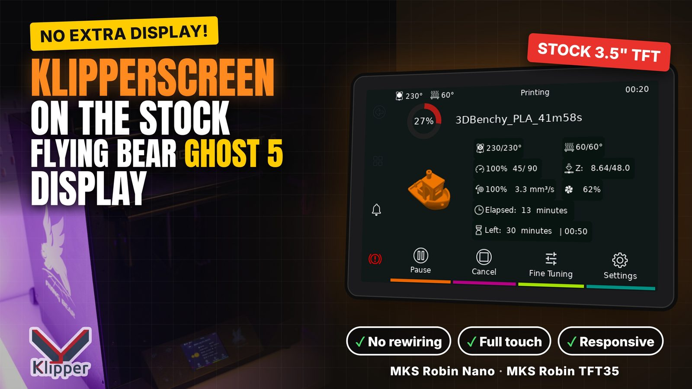
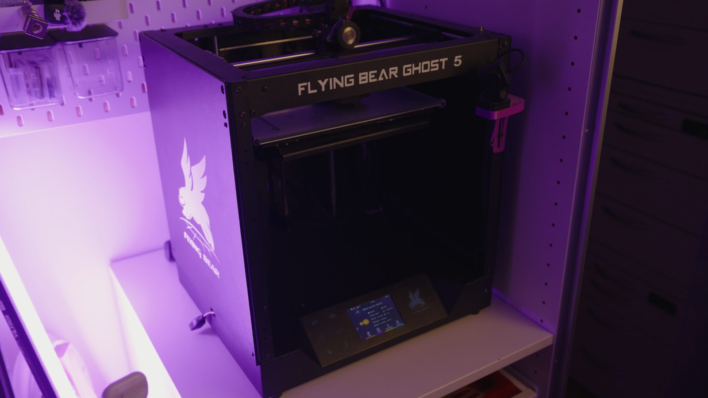
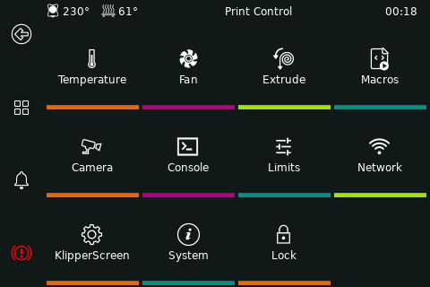
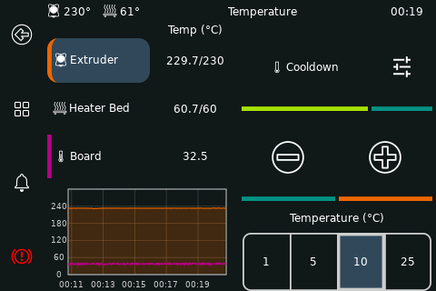
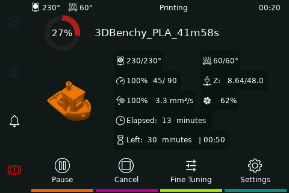
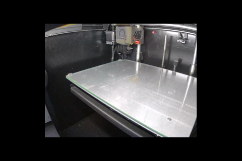
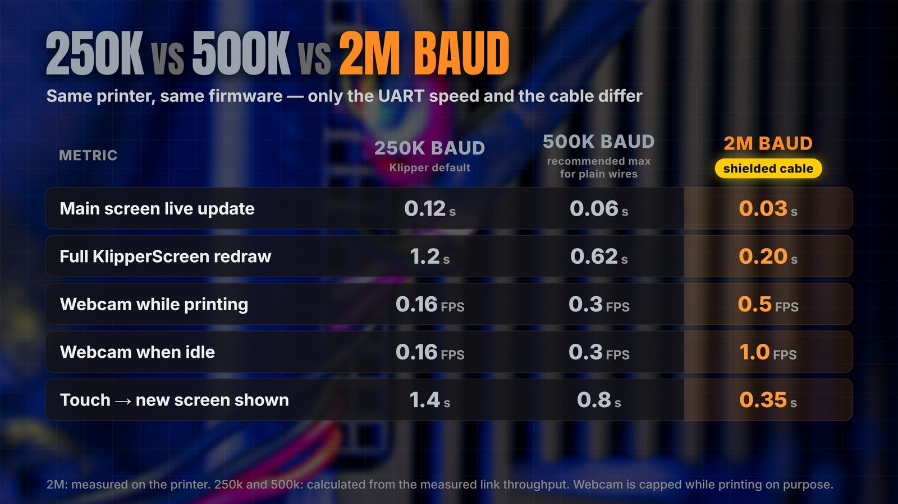
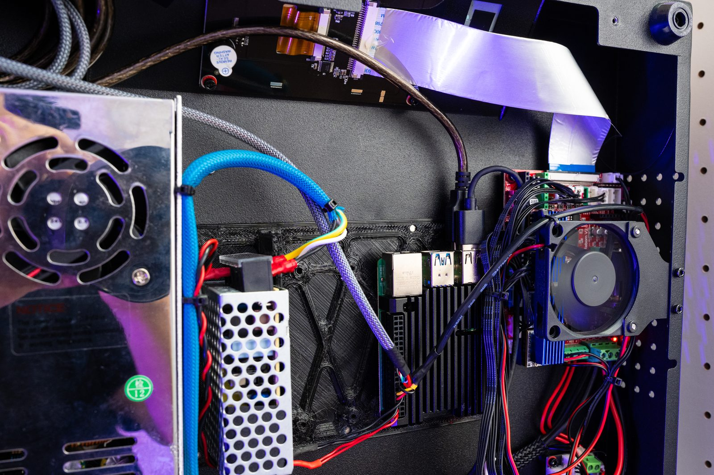
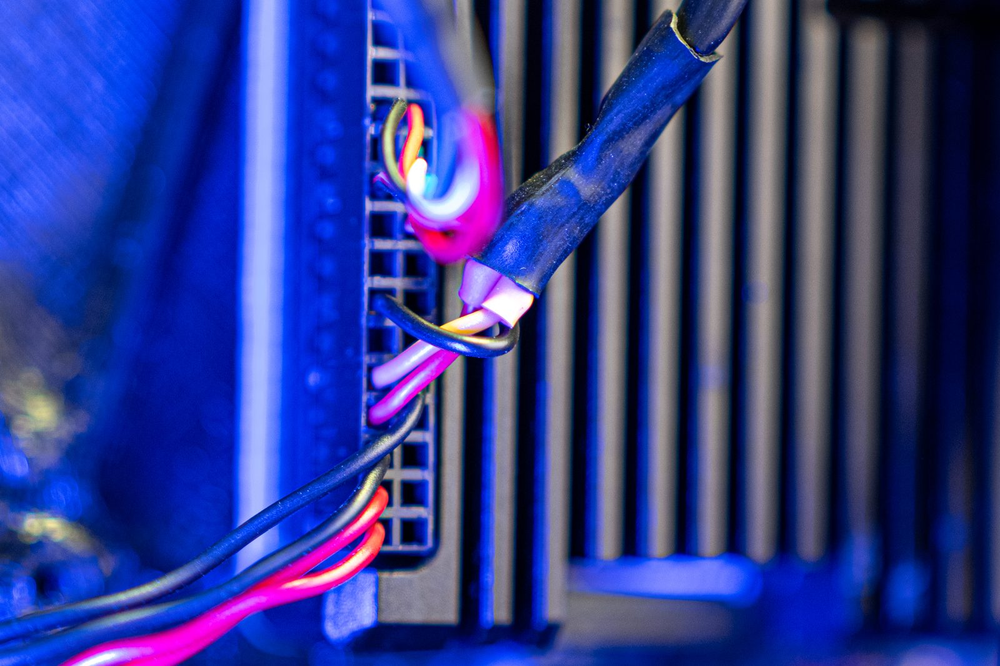
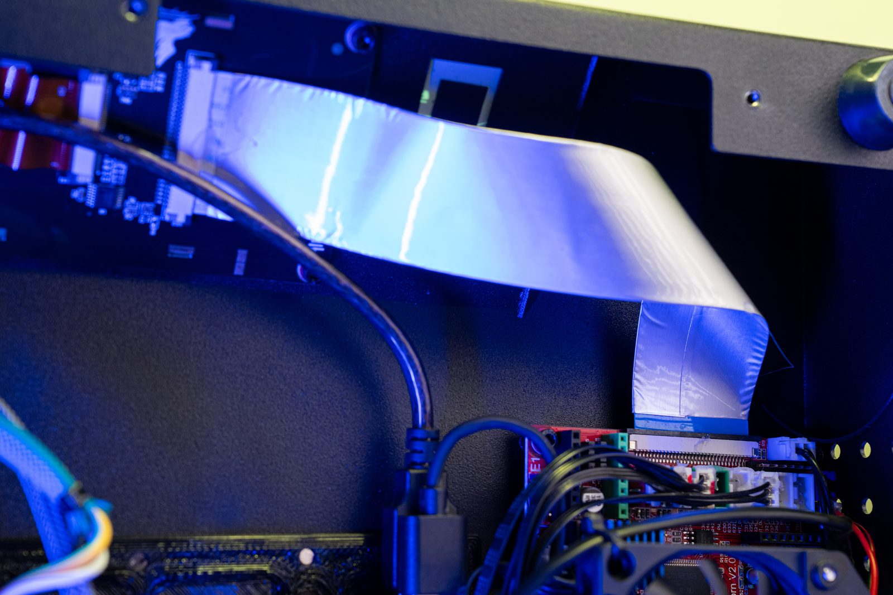

# KlipperScreen на родном экране Flying Bear Ghost 5

[English](README.md) | **Русский**

Полноценный сенсорный интерфейс [KlipperScreen](https://github.com/KlipperScreen/KlipperScreen) на **штатном 3.5" сенсорном экране** Flying Bear Ghost 5 под Klipper. Не нужны ни дополнительный дисплей, ни HDMI-экран, ни плата-переходник, экран не надо перепаивать. Родной экран остаётся на родном шлейфе: Raspberry Pi рисует KlipperScreen, а микроконтроллер принтера выводит картинку на панель.

[](https://www.youtube.com/watch?v=BQfQFEFxjDU)

▶ **Видео:** https://www.youtube.com/watch?v=BQfQFEFxjDU

> [!WARNING]
> **Состояние: работает на принтере автора, установщик не проверялся.**
> Драйвер экрана, зеркалирование и тач работают на одном Ghost 5, на нём напечатаны реальные модели (Benchy, OrcaCube) на 500k, 1.5M и 2M бод.
> `install.sh`, `uninstall.sh` и `set-baud.sh` написаны **после** этого по шагам, которые делались вручную, и **ни разу не запускались на чистой системе**. Скорее всего, что-то придётся поправить.
>
> **Очень советую ставить вместе с ИИ-ассистентом для кода** (Claude Code, Codex, Cursor и т.п.), у которого есть доступ к Pi по SSH: он прочитает скрипты и логи и поправит то, что сломается. Автор так и сделал весь проект с нуля, не имея опыта во встраиваемых системах. Прошивку принтера вы меняете на свой риск.



| Меню | Температура | Печать | Камера |
|---|---|---|---|
|  |  |  |  |

## Железо

| Что | Что именно |
|---|---|
| Принтер | Flying Bear Ghost 5 |
| Плата | штатная **Flying Bear Reborn V2.0**, клон **MKS Robin Nano 1.x**; МК **STM32F103VET6** (512 КБ flash, 64 КБ RAM). Оригинальная Robin Nano V1.1/V1.2 должна работать так же (не проверялось) |
| Экран | штатный 3.5" TFT **480x320**, контроллер **ILI9488**, **16-битная параллельная шина (FSMC)**; совместим с модулем MKS Robin TFT35 |
| Тач | резистивный, совместимый с XPT2046 (HR2046), на SPI2; линии прерывания нет, опрос |
| Хост | Raspberry Pi (у автора: Pi 4 B, Raspberry Pi OS bullseye 32 бит, образ FluiddPi) |
| Связь Pi ↔ МК | UART: GPIO14/15 Pi ↔ разъём Wi-Fi-модуля на плате (USART1, PA9/PA10) |

Ключевые слова: Flying Bear Ghost 5, FB5, Flying Bear Reborn V2.0, MKS Robin Nano v1.1 / v1.2, MKS Robin TFT35, TFT35, ILI9488, XPT2046, FSMC, STM32F103, Klipper, KlipperScreen, родной экран, штатный дисплей, оригинальный тачскрин.

## Как это работает

```
Raspberry Pi                                      Плата Robin Nano (МК с Klipper)
┌───────────────────────────────┐   UART        ┌──────────────────────────────┐
│ KlipperScreen на Xvfb 480x320 │  500k–2M бод  │ fsmc_lcd: распаковка → FSMC  │──▶ экран ILI9488
│ fb5-mirror: изменения, RLE    ├──────────────▶│ (+ обычный Klipper: моторы,  │
│ fb5-touch: касания → X        │◀──────────────┤   нагреватели, концевики...) │◀── тач XPT2046
└───────────────────────────────┘               └──────────────────────────────┘
```

- На Pi KlipperScreen работает на виртуальном экране 480x320 (Xvfb).
- `fb5-mirror` отправляет только изменившиеся части картинки в сжатом виде (RLE) через API самого Klipper по обычной связи Pi ↔ МК.
- В прошивку Klipper добавлен небольшой **драйвер экрана на FSMC** (`fsmc_lcd`) и **чтение тача**, на хосте — модули `[fsmc_display]` и `[fsmc_touch]`. `fb5-touch` превращает касания в нажатия мыши.
- Трафик экрана всегда идёт с **низшим приоритетом**: команды моторов и нагревателей экран никогда не задерживает. Во время печати поток экрана ограничен (по умолчанию 64 КиБ/с), поэтому камера во время печати медленнее.
- **Приём UART через DMA** на МК: высокие скорости работают надёжно, даже когда двигаются все моторы.
- **Katapult** стоит в цепочке после загрузчика MKS: после первой прошивки с SD-карты прошивку можно обновлять по UART.

## Скорость



| | 250k бод (по умолчанию в Klipper) | **500k бод** (по умолчанию здесь) | 2M бод (экранированный кабель) |
|---|---|---|---|
| Обновление главного экрана | 0.12 с | 0.06 с | 0.03 с |
| Полная перерисовка KlipperScreen | 1.2 с | 0.62 с | 0.20 с |
| Камера во время печати | 0.16 к/с | 0.3 к/с | 0.5 к/с |
| Камера в простое | 0.16 к/с | 0.3 к/с | 1.0 к/с |
| Касание → новый экран | 1.4 с | 0.8 с | 0.35 с |

2M измерено на принтере; 250k и 500k рассчитаны по измеренной пропускной способности связи (20.6 КиБ/с на 250k, ~42 КБ/с на 500k, ~165 КБ/с на 2M).

## Что нужно

- Klipper уже работает на Ghost 5 с Raspberry Pi, **подключённым по UART** Pi (GPIO14/15, `/dev/ttyAMA0`) к разъёму Wi-Fi на плате, **не по USB**. У автора в `/boot/config.txt` стоят `enable_uart=1` и `dtoverlay=uart0`; более распространённый способ получить полноценный UART PL011 на GPIO14/15 — `dtoverlay=disable-bt`.
- Провода: TX ↔ RX крест-накрест плюс GND. Для 500k хватает обычных проводов. Для 1.5M / 2M нужен **экранированный** двужильный кабель: TX и RX по жилам, экран = GND на обоих концах, подальше от проводов моторов и нагревателей.
- SD-карта FAT32 для первой прошивки.
- `printer.cfg` в `~/printer_data/config` (раскладка KIAUH / MainsailOS / FluiddPi) с секцией `[mcu]` прямо в нём. Другие пути: см. `scripts/fb5-env.sh`, свои значения кладутся в `fb5.conf`.

| Внутри принтера автора | Провода UART на GPIO Pi | Родной шлейф экрана (не тронут) |
|---|---|---|
|  |  |  |

## Установка

На Pi (не от root):

```bash
git clone https://github.com/Aregus393/FB5-klipperscreen-for-native-display.git
cd FB5-klipperscreen-for-native-display
./install.sh --check     # проверит систему и покажет, что изменится; ничего не меняет
./install.sh             # спросит подтверждение; sudo нужен для apt
```

`install.sh`:

1. ставит пакеты apt (Xvfb, зависимости KlipperScreen, компилятор ARM);
2. переключает `~/klipper` на ветку [`fb5-native-display` в Aregus393/klipper](https://github.com/Aregus393/klipper/tree/fb5-native-display) (Klipper + драйвер экрана; прежняя ветка сохраняется для `uninstall.sh`);
3. клонирует [Katapult с правками для цепочки после загрузчика MKS](https://github.com/Aregus393/katapult/tree/fb5-native-display);
4. ставит KlipperScreen, если его нет (со своим venv), и патчит панель камеры, чтобы картинка занимала половину площади экрана; служба KlipperScreen для HDMI-экрана отключается;
5. добавляет `[include fb5-display.cfg]` в `printer.cfg` и ставит `[mcu] baud: 500000` (копия в `state/`);
6. собирает образ прошивки для SD `firmware/500000/Robin_nano35.bin`;
7. включает автозапуск (crontab `@reboot`).

Дальше:

1. **Прошить МК с SD-карты.** Скопируйте `firmware/500000/Robin_nano35.bin` (или `Robin_nano35.bin` из `fb5-firmware-500k.zip` в [релизе](../../releases)) в корень SD-карты FAT32, вставьте её в плату и включите принтер. Загрузчик MKS прошьёт файл и переименует его в `ROBIN_NANO35.CUR`. Сам загрузчик MKS не трогается.
2. Klipper подключится на 500000 бод и проинициализирует экран.
3. Запустите экран: `scripts/ks-start.sh` (или перезагрузите Pi). KlipperScreen подключается к Moonraker около 30 с.
4. Если касания промахиваются: `scripts/ks-start.sh stop`, `python3 scripts/fb5-touch-cal.py` (нажимать красные мишени), `scripts/ks-start.sh`.

> [!IMPORTANT]
> Не обновляйте Klipper через Moonraker / Mainsail / Fluidd: это вернёт `~/klipper` на обычный Klipper без драйвера экрана.

## Выбор скорости связи

По умолчанию **500 000 бод**: проверено реальными печатями на обычных проводах, ни одной ошибки передачи при движении всеми моторами. Быстрее — экран заметно приятнее, но нужен экранированный кабель — **на свой риск**:

```bash
./set-baud.sh 2000000      # или 1500000, или обратно 500000
```

Скрипт собирает прошивку под эту скорость, прошивает её по UART (Katapult) и меняет `printer.cfg`. Допустимы только 250000, 500000, 1500000 и 2000000: у них целые делители и у МК, и у Pi; выше 2 250 000 МК не умеет. Готовые прошивки на 500k, 1.5M и 2M есть в [релизе](../../releases).

Проверки (без нагрева, пруток лучше вынуть): `python3 scripts/fb5-motion-test.py --speed 150 --accel 5000 --circles 8 --e-ratio 0` (все моторы по кругу, отчёт об ошибках связи), `scripts/link-test.sh` (скорость и ошибки при передаче полного кадра; потом `scripts/mirror-restart.sh`), `scripts/print-monitor.py` (запустить перед печатью, пишет состояние связи до конца печати), G-code `SERIAL_ERRORS` (ошибки приёма UART на МК).

Если после смены скорости Klipper не подключается: прошейте SD-образ на 500k, как при установке, и выполните `python3 scripts/set-mcu-baud.py ~/printer_data/config/printer.cfg 500000`.

## Обслуживание

| Что случилось | Что делать |
|---|---|
| На экране мусор или старая картинка, сам KlipperScreen работает | `scripts/mirror-restart.sh` (можно во время печати) |
| KlipperScreen завис | перезапуск всего стека экрана (не во время печати): `scripts/ks-start.sh stop`, затем `setsid nohup scripts/ks-start.sh > logs/ks-start.log 2>&1 < /dev/null &` |
| После обновления KlipperScreen | `python3 scripts/patch_ks_camera.py`, затем перезапуск стека |
| Размер картинки камеры, лимит потока во время печати | `FB5_CAMERA_AREA=0.5` и `FB5_PRINT_RATE=64` в `fb5.conf` (см. `scripts/fb5-env.sh`), затем перезапуск стека |
| Контраст | `init_overrides` в `fb5-display.cfg` (подобрано на панели автора: `0xC0 09 0B`, `0xC5 00 90 80`) |

Логи: `logs/` (`mirror.log`, `touch.log`, `klipperscreen.log`, `xvfb.log`, `ks-start.log`) и собственный лог KlipperScreen `~/printer_data/logs/KlipperScreen.log`.

Ловушка: скрипты останавливают процессы через `pkill -f`. В однострочнике `ssh pi@printer "..."` не упоминайте после скрипта имена других процессов (`fb5-mirror.py --xvfb`, `screen.py`, `ks-loop.sh`) — `pkill` может убить саму SSH-команду. В интерактивной SSH-сессии такой проблемы нет.

`examples/fb5-macros.cfg`: необязательные исправления макросов [ODUCCEU](https://github.com/oducceu/klipper_configs) для Ghost 5 — `LOAD_FILAMENT` / `UNLOAD_FILAMENT`, которые вызывают кнопки KlipperScreen, и `PAUSE`, после которого печать больше не продолжается на 10 мм выше детали при повторной паузе.

## Удаление и откат

```bash
./uninstall.sh
```

Скрипт останавливает экран, убирает автозапуск и `[include fb5-display.cfg]`, возвращает `~/klipper` на сохранённую ветку и восстанавливает панель камеры KlipperScreen. На МК остаётся прошивка FB5 (Klipper продолжает работать), пока вы не прошьёте обычную сборку Klipper с SD-карты; скрипт подскажет как.

## Что где лежит

- `install.sh`, `uninstall.sh`, `set-baud.sh` — см. выше.
- `scripts/` — работает на Pi: `ks-start.sh` / `ks-loop.sh` (Xvfb + KlipperScreen), `fb5-mirror.py`, `fb5-touch.py`, `fb5-touch-cal.py`, `build-firmware.sh`, `flash-uart.sh`, тесты.
- `config/` — `fb5-display.cfg` (пины, инициализация панели), калибровка тача по умолчанию, конфиги сборки прошивки.
- Исходники прошивки (GPL-3.0): [Aregus393/klipper `fb5-native-display`](https://github.com/Aregus393/klipper/tree/fb5-native-display) (19 коммитов поверх Klipper 9cb99754), [Aregus393/katapult `fb5-native-display`](https://github.com/Aregus393/katapult/tree/fb5-native-display) (3 коммита поверх Katapult 3b973a4).

## Благодарности

- [Klipper](https://github.com/Klipper3d/klipper), [Katapult](https://github.com/Arksine/katapult), [KlipperScreen](https://github.com/KlipperScreen/KlipperScreen)
- Инициализация ILI9488 и тайминги FSMC: [Marlin](https://github.com/MarlinFirmware/Marlin)
- Конфиг и макросы Klipper для Ghost 5: [ODUCCEU](https://github.com/oducceu/klipper_configs)
- Сделано вместе с [Claude Code](https://claude.com/claude-code).

## Лицензия

GPL-3.0, как у Klipper и Katapult, которые этот проект изменяет. © 2026 Aregus393
